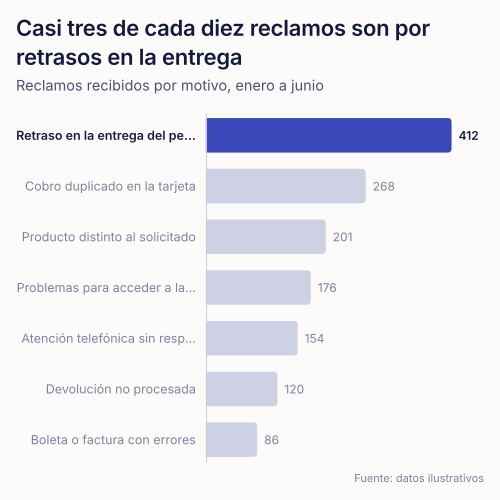
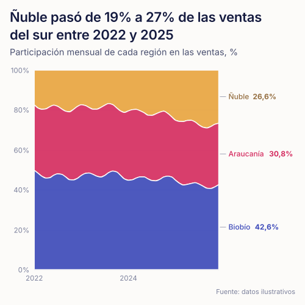
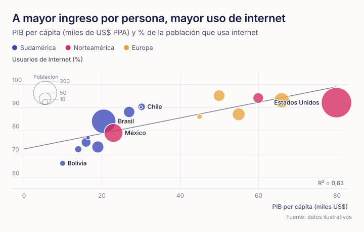
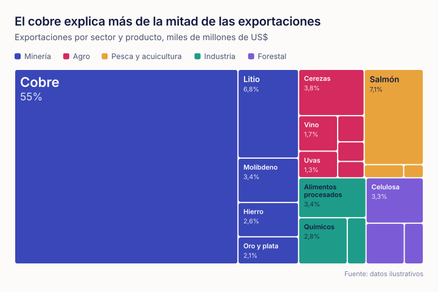
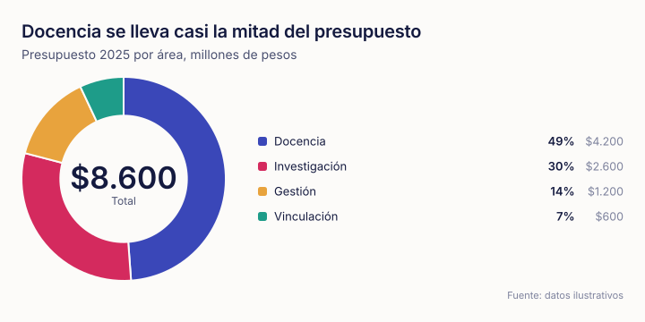
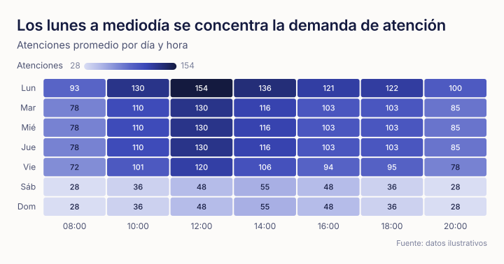
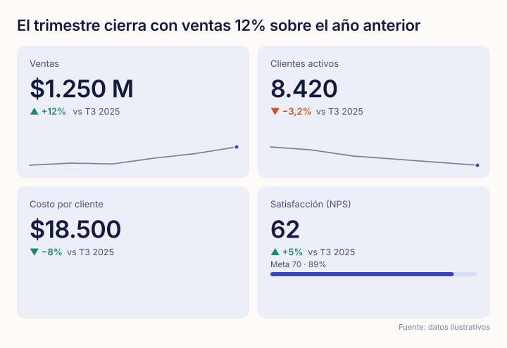

# plotagents

**Gráficos bellos con una sola llamada, pensados para agentes de IA.**
Un objeto JSON con datos y nombres de campos entra; sale un SVG accesible, con buena tipografía, colores validados para daltonismo y tooltips. Sin dependencias. Funciona en Node, Deno, Bun y el navegador.

*Beautiful charts from one JSON spec, built for AI agents. Zero dependencies, SVG output, Spanish and English number formats.*

```bash
npm install plotagents
```

```js
import { plot } from 'plotagents';

const svg = plot({
  title: 'Biobío concentra el 30% de las ventas del sur',
  subtitle: 'Ventas por región, millones de pesos, 2025',
  source: 'datos ilustrativos',
  data: [
    { region: 'Biobío', ventas: 1240 },
    { region: 'Araucanía', ventas: 880 },
    { region: 'Ñuble', ventas: 610 },
  ],
  x: 'region',
  y: 'ventas',
});
```


Abre [`examples/index.html`](examples/index.html) para ver la galería interactiva con el código de cada gráfico.

## Por qué

Los agentes producen buenos datos y malos gráficos: dobles ejes, tortas de 12 colores, títulos que no dicen nada. plotagents saca las decisiones de diseño de las manos del agente. Las reglas vienen de los cursos de visualización de datos para la gestión (Wilke, *Fundamentals of Data Visualization*; datavizcatalogue; el Atlas de Complejidad Económica) y están escritas en el código:

- **El título es un hecho.** `lint` lo sugiere y `describe` genera el texto alternativo.
- **Un eje.** No hay doble eje; `index: true` lleva series de escalas distintas a base 100.
- **Color por identidad, en orden fijo.** Ocho colores validados para daltonismo (ΔE OKLab ≥ 8 entre vecinos bajo protanopía y deuteranopía); desde la novena serie, gris "Otros".
- **Marcas finas, grilla recesiva.** Barras de 4 px de radio en el extremo del dato, líneas de 2 px, separación de 2 px entre segmentos, sin bordes.
- **Etiquetas selectivas.** Valor en la punta de las barras, al final de las líneas, solo los puntos que importan en una dispersión.
- **Formato chileno por defecto.** `1.234,5`, `56,1%`, `$18.500`, `1.250 M`. `locale: 'en'` para inglés.

## Tipos

| `type` | Para | Ejemplo |
|---|---|---|
| `bar` | Comparar categorías. Columnas o barras horizontales según las etiquetas; agrupadas, apiladas o al 100%. |  |
| `line` | Evolución en el tiempo, con anotaciones, metas e índice base 100. |  |
| `area` | Volumen en el tiempo; apila si hay series. |  |
| `scatter` / `bubble` | Relación entre dos medidas; tamaño, escala log, tendencia y R². |  |
| `treemap` | Partes de un todo con jerarquía. |  |
| `donut` / `pie` | Parte-todo con 6 partes como máximo. |  |
| `heatmap` | Magnitud en una grilla de dos categorías. |  |
| `sankey` | Flujos entre etapas. |  |
| `kpi` | Uno o varios números con variación, tendencia y meta. |  |

Si no indicas `type`, se infiere: fechas → `line`, dos medidas → `scatter`, `source`/`target` → `sankey`, categorías → `bar`.

## API

```js
import { plot, safePlot, lint, describe, render, toHTML, schema, toolDefinition } from 'plotagents';
```

| Función | Devuelve |
|---|---|
| `plot(spec)` | SVG (string). Lanza `PlotError` con una pista de corrección. |
| `safePlot(spec)` | `{ ok, svg, description, errors, warnings, suggestions }`. Nunca lanza. |
| `lint(spec)` | Revisión del spec sin dibujar: errores y sugerencias de diseño. |
| `describe(spec)` | Texto alternativo ("Mayor: Biobío con 1.240 (30%)…"). |
| `render(el, spec)` | Navegador: dibuja con tooltips y ancho adaptable. |
| `toHTML(specs)` | Página HTML autónoma con uno o varios gráficos interactivos. |
| `schema` | JSON Schema del spec. |
| `toolDefinition({ flavor })` | Definición de herramienta para Claude (`anthropic`) u OpenAI (`openai`). |

### Spec

| Campo | Qué hace |
|---|---|
| `data` | Filas: `[{ region: 'Biobío', ventas: 1240 }]`. También `{ A: 1, B: 2 }`. |
| `x`, `y`, `series` | Campos de cada rol. `y` acepta una lista (tabla ancha → series). |
| `value`, `label`, `path`, `size`, `from`, `to` | Campos de treemap, dona, burbujas y sankey. |
| `title`, `subtitle`, `source` | Hallazgo, cómo leerlo y fuente. |
| `highlight` | Destaca una o más categorías/series y atenúa el resto. |
| `stack` | `true` o `'percent'` en barras y áreas. |
| `refLines`, `annotations` | Metas, umbrales y eventos. |
| `format` | `'number'`, `'compact'`, `'percent'`, `'currency'`, `'integer'` o `{ prefix, suffix, decimals, currency }`. |
| `index` | Líneas en base 100. |
| `top`, `sort` | Corte y orden en barras. |
| `theme` | `'papel'` (claro), `'noche'` (oscuro) u objeto `{ extends: 'papel', categorical: [...] }`. |
| `locale` | `'es'` (por defecto) o `'en'`. |
| `width`, `height` | En px. Barras horizontales, heatmap y KPI calculan su alto. |

Los tipos completos están en [`index.d.ts`](index.d.ts).

## Como herramienta de un agente

```js
import Anthropic from '@anthropic-ai/sdk';
import { safePlot, toolDefinition } from 'plotagents';

const client = new Anthropic();
const res = await client.messages.create({
  model: process.env.ANTHROPIC_MODEL, // el modelo que uses
  max_tokens: 4096,
  tools: [toolDefinition()],
  messages: [{ role: 'user', content: 'Grafica las ventas por región de este CSV: …' }],
});
const call = res.content.find((b) => b.type === 'tool_use');
const { ok, svg, errors, suggestions } = safePlot(call.input);
// Si !ok, devuelve `errors` al modelo como tool_result: cada error trae su `fix`.
```

[`AGENTS.md`](AGENTS.md) es una guía corta para pegar en el prompt de sistema de un agente.

## CLI

```bash
npx plotagents spec.json -o grafico.svg      # SVG
npx plotagents specs.json -o reporte.html    # varios gráficos en una página
npx plotagents spec.json --lint              # revisión y sugerencias
npx plotagents --tool                        # definición de herramienta
```

## Paleta

| Tema | Fondo | Categórica (orden fijo) |
|---|---|---|
| `papel` | `#FCFBF9` | `#3A47B8` `#D42A5E` `#E8A33D` `#1E9C89` `#7B5CD6` `#B5562E` `#5BA3E0` `#8E9A2F` |
| `noche` | `#0B0F2B` | `#6170E0` `#E63369` `#C4851C` `#22A892` `#9780E8` `#D06A3E` `#499BDA` `#909D2D` |

Ambas pasan las comprobaciones de banda de luminosidad, croma mínimo, separación bajo daltonismo entre vecinos y separación con visión normal. El orden es parte de la validación: índigo, magenta y ámbar se distinguen entre todos los pares, por eso una dispersión con más de 3 grupos recibe una advertencia. Tipografía: Mozilla Text (con respaldo `system-ui`).

## Desarrollo

```bash
npm test                 # pruebas (node:test)
npm run examples         # regenera examples/svg y examples/index.html
```

MIT © Carlos Navarrete
