# plotagents

**Beautiful charts from a single JSON spec, built for AI agents.**

**[Documentation, live examples and playground →](https://carlosnavarrete.cl/plotagents/)**

Data and field names go in; an accessible SVG comes out, with careful typography, colorblind-safe colors and tooltips. 33 chart types: the ones people reach for in seaborn, multi-level treemaps and sunbursts, choropleth maps of Chile, the United States and the world, networks, chord diagrams, population pyramids, flow charts and Gantt charts, plus time sliders, small multiples and fully JSON-configurable themes. Zero dependencies. Runs in Node, Deno, Bun and the browser.

```bash
npm install plotagents
```

```js
import { plot } from 'plotagents';

const svg = plot({
  title: 'Biobío accounts for 30% of southern sales',
  subtitle: 'Sales by region, CLP millions, 2025',
  source: 'illustrative data',
  data: [
    { region: 'Biobío', sales: 1240 },
    { region: 'Araucanía', sales: 880 },
    { region: 'Ñuble', sales: 610 },
  ],
  x: 'region',
  y: 'sales',
  locale: 'en',
});
```

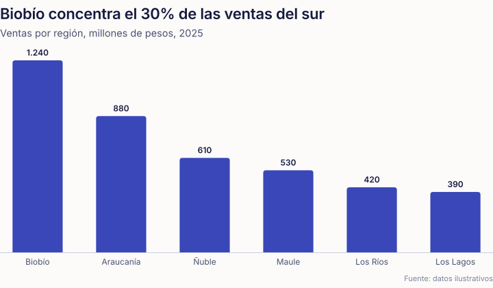

The [interactive gallery](https://carlosnavarrete.cl/plotagents/examples/), 61 charts with the code for each one, is also in [`examples/index.html`](examples/index.html). Try any spec live in the [playground](https://carlosnavarrete.cl/plotagents/playground/).

## Why

Agents are good at data and bad at charts: dual axes, 12-slice pies, titles that say nothing. plotagents takes design decisions out of the agent's hands. The rules come from data-visualization teaching for management (Wilke's *Fundamentals of Data Visualization*, the Data Viz Catalogue, the Atlas of Economic Complexity) and are written into the code:

- **The title states the finding.** `lint` nudges toward it and `describe` writes the alt text.
- **One axis.** There is no dual axis; `index: true` rebases series to 100 and `facet` draws panels on a shared scale.
- **Labels at the end of every line**, always. When they collide they are spread apart and joined to their point by a thin leader line; a legend appears only when needed.
- **Every pixel for the data.** The y axis sits inside the plot on its gridline; margins and type scale down on phones; treemaps, sunbursts, horizontal bars, heatmaps and KPI tiles size their own height.
- **Color follows the entity.** Eight validated colors in a fixed order; "Copper" keeps its color when you filter, drill down or move the time slider. One solid color per category.
- **Legend and chart are connected.** Hover a legend key to light up its marks, click to pin; line labels and tooltip headers wear their series color.
- **Estimates look like estimates.** `dashed` hatches the shapes that are projections or provisional figures (same color, striped fill, dashed outline) and `dashedFrom: 2025` turns lines, areas and columns dashed from that point on, over a soft labeled band. The legend says what the hatching means; hovering it lights up just those shapes.
- **Maps you can explore.** Click a state or region to zoom to it, Ctrl/⌘ + scroll or pinch to zoom, drag to pan; +/−/reset buttons for the keyboard. Hovering outlines the shape instead of dimming the map, and each color class in the legend lights up its regions. With a time slider, colors glide from one year to the next.
- **Networks you can explore.** Click a node and it glides to the center with its connections highlighted; click again or press Esc to go back.
- **Thin marks, quiet grid.** 4 px rounded data ends, 2.25 px lines, 2 px surface gaps instead of borders.
- **Locale-aware numbers.** Spanish (Chile) by default: `1.234,5`, `56,1%`, `$18.500`. `locale: 'en'` gives `1,234.5`.

## Chart types

| Purpose | `type` (aliases) |
|---|---|
| Compare categories | `bar` (`barplot` with confidence intervals), `count` (`countplot`) |
| Change over time | `line` (`lineplot`, `ci` for a confidence band), `area` |
| Relationships | `scatter`, `bubble`, `regplot` (`lmplot`), `residplot`, `jointplot` |
| Profiles | `radar` (`spider`) |
| Distributions | `hist` (`histplot`), `kde` (`kdeplot`), `ecdf`, `box` (`boxplot`), `violin`, `strip`, `swarm` (`beeswarm`), `point` (`pointplot`) |
| Part-to-whole | `treemap` (any depth, with % change over time), `sunburst`, `donut`, `pie` |
| Maps | `choropleth` (Chile by region, US by state, world by country, or your own GeoJSON / TopoJSON with markers, layers and framing), `symbolmap` |
| Projects | `gantt` (`timeline`, `roadmap`): phases, progress, milestones, dependencies and a today line |
| Networks and flows | `network`, `chord`, `sankey`, `flowchart` (with swimlanes) |
| Populations | `pyramid` |
| Grids | `heatmap` |
| Numbers | `kpi` |

Leave `type` out and it is inferred: dates → `line`, two measures → `scatter`, `source`/`target` → `sankey`, `path` → `treemap`, categories → `bar`. Every option is documented in [`docs/charts.md`](docs/charts.md).

| | | |
|---|---|---|
| 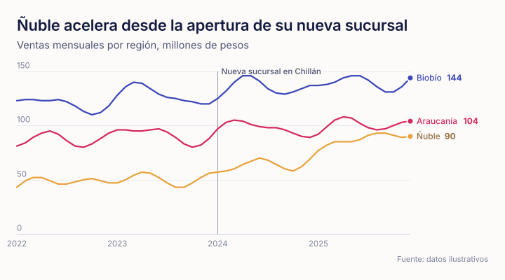 | 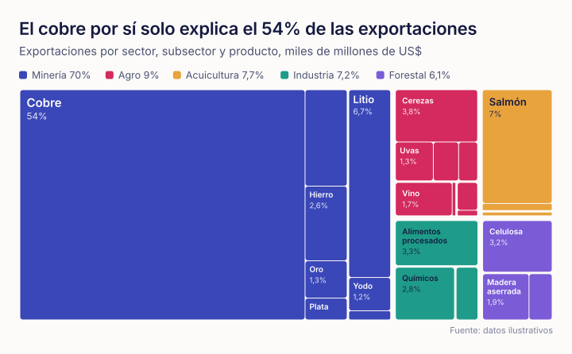 | 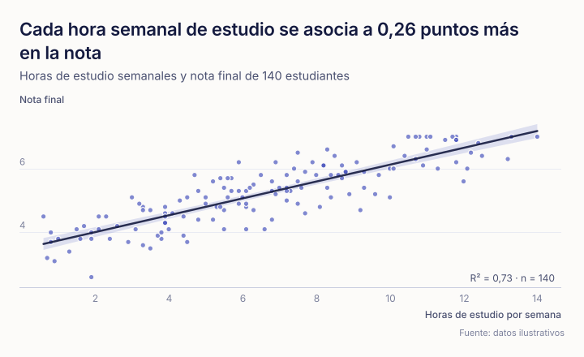 |
| 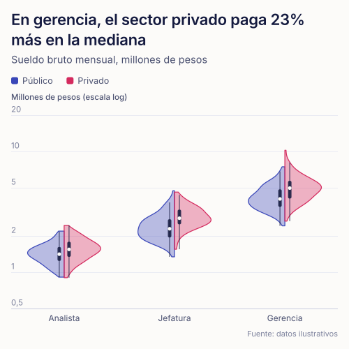 | 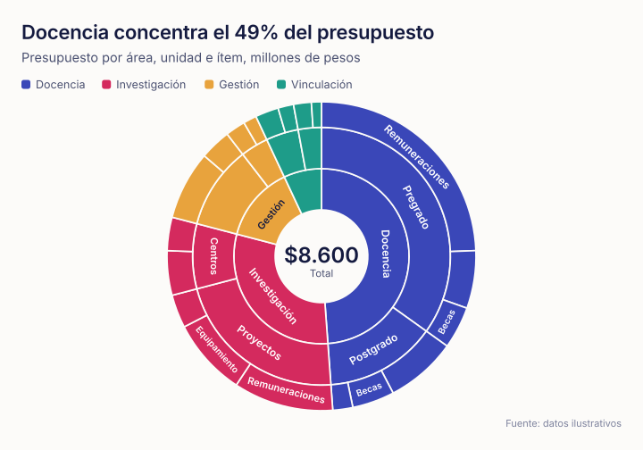 | 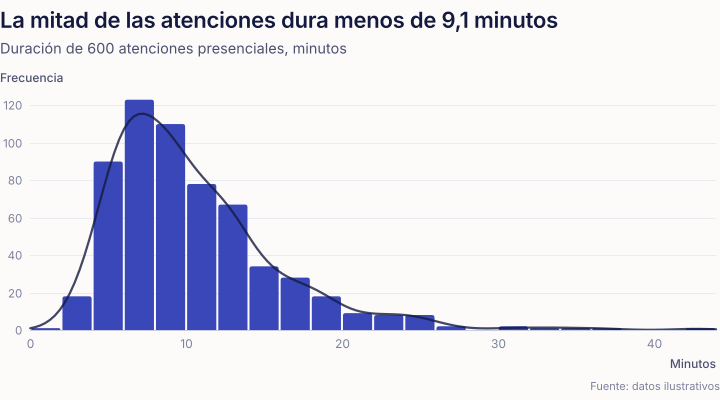 |
| 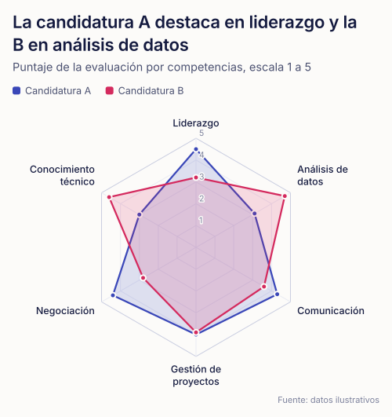 | 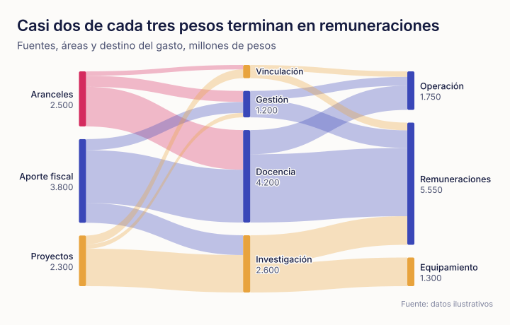 | 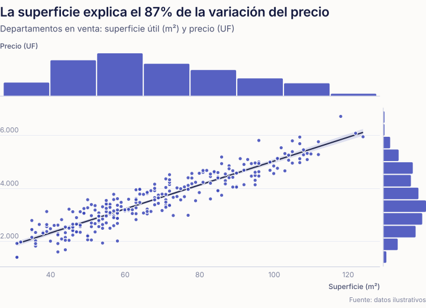 |
| 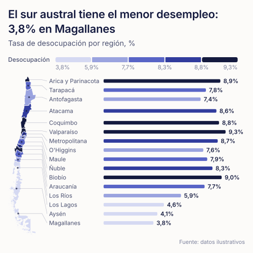 | 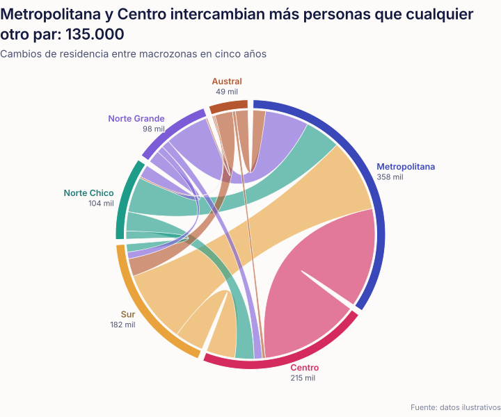 | 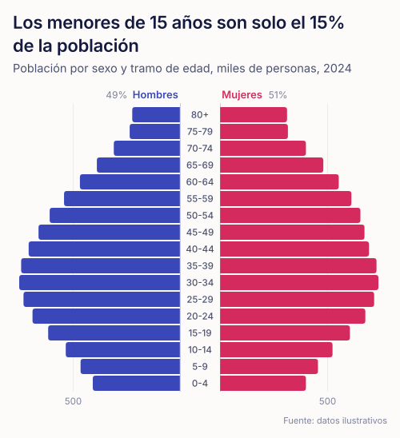 |

## Time, panels and drill-down

```js
// One period at a time with a slider and a play button (d3plus-style `time`).
plot({ type: 'treemap', data, path: ['sector', 'product'], value: 'value', time: 'year' });

// Time series: in the browser, render() adds a range slider with an overview.
render('#chart', { type: 'line', data, x: 'month', y: 'sales', series: 'region' });

// Small multiples (seaborn's col / col_wrap) with shared scales and colors.
plot({ type: 'area', data, x: 'month', y: 'sales', facet: 'region', columns: 3 });

// Treemaps and sunbursts of any depth; click a group to drill down.
plot({ type: 'sunburst', data, path: ['area', 'unit', 'item'], value: 'amount', focus: ['Teaching'] });

// Log scales with 1-2-5 ticks and no empty decades.
plot({ type: 'line', data, x: 'month', y: 'users', series: 'platform', yScale: 'log' });
```

## One switch for fonts and text size

```js
import { configure } from 'plotagents';

configure({ font: 'Poppins', textScale: 1.5 });   // every chart from now on
plot({ ...spec, textScale: 2 });                  // or per chart: presentation mode
configure(null);                                  // back to defaults
```

`font` takes a Google Fonts name (it is loaded for you in the browser and in `toHTML()`), a CSS stack or `{ family, import }`. `textScale` multiplies every text size and the layout is recomputed with the real sizes, so labels at ×2 still never overlap. `configure()` also accepts `locale`, `theme`, `palette` or any other spec option.

## Themes are JSON

Everything visual is a JSON object merged over a base theme, so an agent can apply a brand without touching code. See [`docs/themes.md`](docs/themes.md).

```js
plot({
  ...spec,
  theme: {
    extends: 'papel',              // or 'noche' (dark)
    categorical: 'okabe-ito',      // palette name or a list of colors in fixed order
    surface: '#FFFFFF',
    font: { family: "'Poppins', sans-serif" },
    type: { title: 22, titleWeight: 700 },
    marks: { lineWidth: 3, barRadius: 8, barMax: 44 },
    axes: { inside: false },
  },
});
```

`validatePalette(colors)` checks a custom palette with the same tests the built-in one passed (lightness band, chroma floor, colorblind separation, normal-vision separation), and `lint` runs it for you.

## SVG, not Canvas

plotagents renders SVG. Dense charts (more than 1,500 points) are drawn automatically as one path per color, with a nearest-point tooltip layer, which paints faster than Canvas while keeping vector output, server-side rendering and accessible text. The benchmark and the reasoning are in [`docs/rendering.md`](docs/rendering.md).

| Points | SVG, one node per point | Canvas | plotagents (batched SVG) |
|---|---|---|---|
| 5,000 | 62 ms | 30 ms | 12 ms |
| 20,000 | 671 ms | 100 ms | 38 ms |
| 50,000 | 1,468 ms | 357 ms | 123 ms |

## API

```js
import { plot, safePlot, lint, describe, render, toHTML, schema, toolDefinition, validatePalette } from 'plotagents';
```

| Function | Returns |
|---|---|
| `plot(spec)` | SVG string. Throws `PlotError` with a fix hint. |
| `safePlot(spec)` | `{ ok, svg, description, errors, warnings, suggestions }`. Never throws. |
| `lint(spec)` | Review of the spec without drawing: errors and design suggestions. |
| `describe(spec)` | Alt text ("Highest: Biobío with 1,240 (30%)…"). |
| `render(el, spec)` | Browser: tooltips, responsive width, time sliders and drill-down. |
| `toHTML(specs)` | A self-contained, interactive HTML page in one file. |
| `schema` / `toolDefinition({ flavor })` | JSON Schema of the spec and a tool definition for Claude (`anthropic`) or OpenAI (`openai`). |
| `validatePalette(colors, opts)` | `{ ok, checks }`. |

In the browser without a bundler, `<script src="dist/plotagents.js"></script>` defines `window.plotagents`. Full types are in [`index.d.ts`](index.d.ts) and every option in [`schema.json`](schema.json).

## As an agent tool

```js
import Anthropic from '@anthropic-ai/sdk';
import { safePlot, toolDefinition } from 'plotagents';

const client = new Anthropic();
const res = await client.messages.create({
  model: process.env.ANTHROPIC_MODEL, // the model you use
  max_tokens: 4096,
  tools: [toolDefinition()],
  messages: [{ role: 'user', content: 'Plot the distribution of service times per clinic: …' }],
});
const call = res.content.find((b) => b.type === 'tool_use');
const { ok, svg, errors, suggestions } = safePlot(call.input);
// If !ok, send `errors` back as the tool_result: every error carries a `fix`.
```

[`AGENTS.md`](AGENTS.md) is a short guide meant to be pasted into an agent's system prompt.

## CLI

```bash
npx plotagents spec.json -o chart.svg       # SVG
npx plotagents specs.json -o report.html    # several interactive charts on one page
npx plotagents spec.json --lint             # review and suggestions
npx plotagents --tool                       # tool definition
```

## Built-in palette

| Theme | Surface | Categorical (fixed order) |
|---|---|---|
| `papel` | `#FCFBF9` | `#3A47B8` `#D42A5E` `#E8A33D` `#1E9C89` `#7B5CD6` `#B5562E` `#5BA3E0` `#8E9A2F` |
| `noche` | `#0B0F2B` | `#6170E0` `#E63369` `#C4851C` `#22A892` `#9780E8` `#D06A3E` `#499BDA` `#909D2D` |

Both pass the lightness, chroma, colorblind (adjacent ΔE OKLab ≥ 8) and normal-vision (≥ 15) checks. The order is part of the validation. Typeface: Mozilla Text, falling back to `system-ui`.

## Development

```bash
npm test                 # tests (node:test)
npm run build            # dist/plotagents.js for the browser
npm run examples         # regenerates examples/svg and examples/index.html
npm run site             # builds the GitHub Pages site into _site/ (docs, gallery, playground)
```

MIT © Carlos Navarrete
